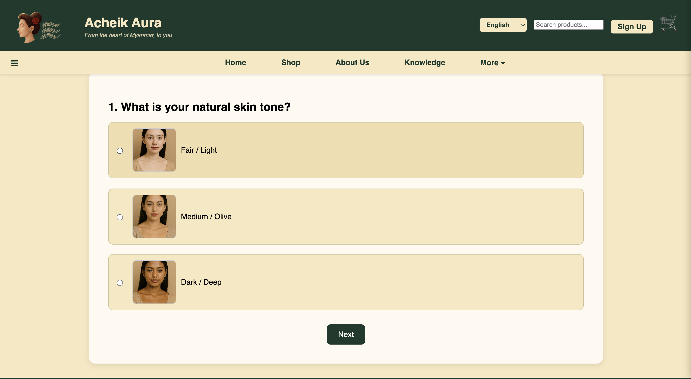

# Acheik Aura

A Django-based e-commerce website showcasing Myanmar's traditional Acheik textiles. Acheik Aura brings traditional textile designs into a digital shopping experience.

## Overview

Acheik Aura is a web development project focused on celebrating Myanmar's textile heritage through an online platform where users can explore Acheik products, browse designs, and learn about traditional textiles.
## Screenshots

### Homepage


### Designer


### Skin Color Analysis


## Features

- **Product Catalog** — Browse Acheik textile products and view product details.
- **Designer Gallery** — Explore traditional textile designs and collections.
- **Skin Color Analysis** — Explore Acheik color recommendations based on skin-tone preferences.
- **Knowledge Hub** — Learn about Acheik textiles, traditional patterns, and fabrics.
- **User Accounts** — Register, log in, and manage user profiles.
- **Shopping Cart and Checkout** — Add products to the cart and proceed through the checkout flow.
- **Order History** — View order-related information.
- **Django Admin** — Manage application data through Django's administration interface.

## Technology Stack

- **Backend:** Python, Django
- **Frontend:** HTML, CSS
- **Database:** SQLite
- **Image Processing:** Pillow
- **Configuration:** python-dotenv

## Project Structure

```text
Acheik-Aura/
├── acheikaura/        # Django project configuration
├── main/              # Main application
│   ├── migrations/    # Database migration files
│   ├── static/        # CSS and static assets
│   └── templates/     # HTML templates
├── media/
│   └── products/      # Product images
├── manage.py
├── requirements.txt   # Python dependencies
├── .gitignore
└── README.md
```

## Getting Started

### Prerequisites

- Python installed on your computer
- Git

### 1. Clone the repository

```bash
git clone https://github.com/ad0rab0nb0n/Acheik-Aura.git
cd Acheik-Aura
```

### 2. Create and activate a virtual environment

On macOS or Linux:

```bash
python3 -m venv .venv
source .venv/bin/activate
```

### 3. Install the dependencies

```bash
python -m pip install -r requirements.txt
```

### 4. Configure environment variables

Generate a new Django secret key locally:

```bash
python -c "from django.core.management.utils import get_random_secret_key; print(get_random_secret_key())"
```

Create a `.env` file in the project root, alongside `manage.py`, and add:

```dotenv
DJANGO_SECRET_KEY=paste-your-generated-secret-key-here
DJANGO_DEBUG=True
DJANGO_ALLOWED_HOSTS=127.0.0.1,localhost
```

Replace the placeholder with your generated secret key. Do not commit your `.env` file or share its secret values.

### 5. Set up the database

```bash
python manage.py migrate
```

To create an administrator account:

```bash
python manage.py createsuperuser
```

Follow the prompts in your terminal.

### 6. Run the development server

```bash
python manage.py runserver
```

Open http://127.0.0.1:8000/ in your browser.

## Notes

- The local SQLite database is not included in the repository. Run the migrations to create a fresh database.
- Product images are included in `media/products/`.
- User-uploaded profile pictures and local environment settings are excluded from version control.
- `DEBUG=True` is intended for local development only. Production deployment requires additional security configuration.

## Purpose

Acheik Aura is a portfolio project exploring Django web development and the digital presentation of Myanmar's traditional textile heritage.
